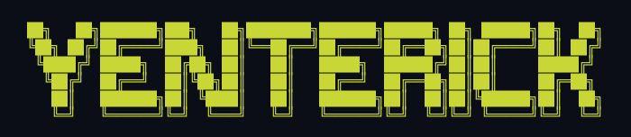

    

  <strong>AI & Systems Engineer · Full-Stack Developer</strong> 
  Systems Engineering Student @ Universidad Libre · Pereira, Colombia

  Building resilient backend architectures, multi-agent AI pipelines, and low-level systems tools. 
  Focused on Rust, C, distributed data infrastructure, and bare-metal performance—from memory-safe CLIs and heuristic solvers to geospatial optimization engines.

---

  
  
  
  
  
   
  
  
  
  
  
   
  
  
  
  
  

---

    
  

---

  
  
   
  
  

---

  
  
  
  
  

